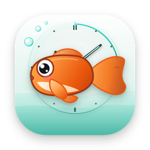
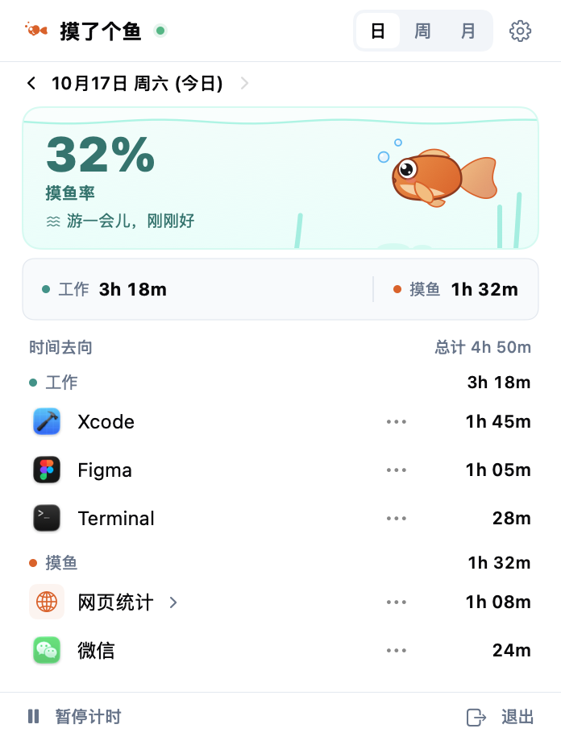
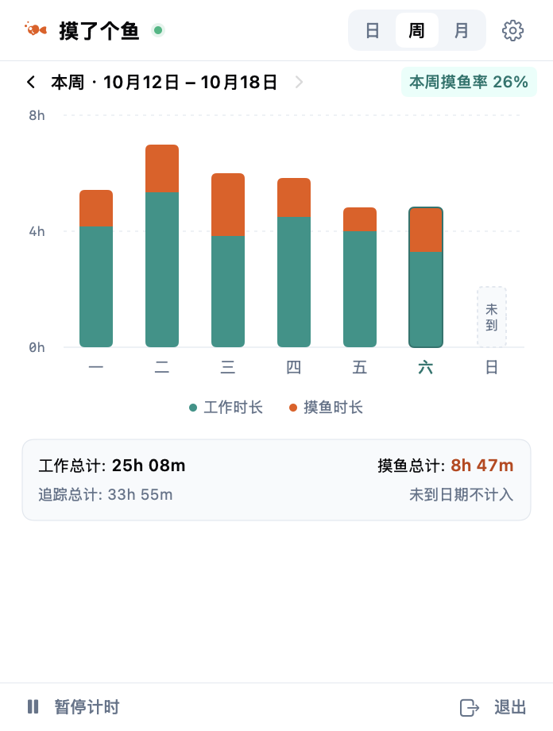
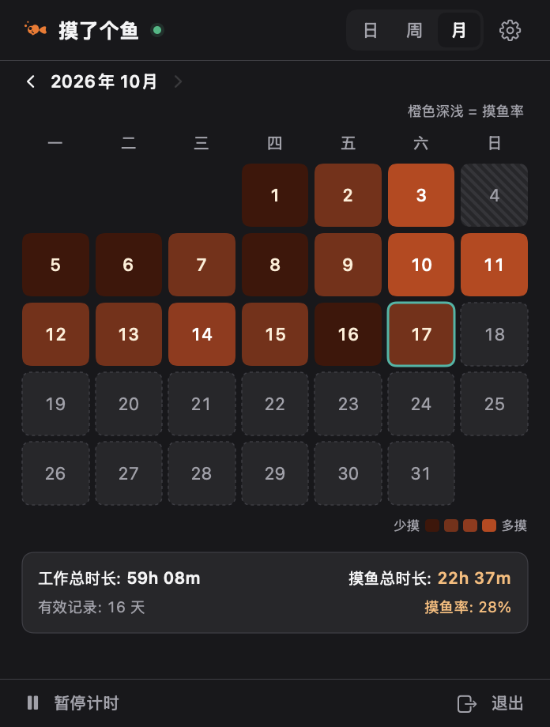

<p align="center">
  
</p>

<h1 align="center">摸了个鱼</h1>

<p align="center">住在 Mac 菜单栏里的时间统计工具。自动记录前台应用和网站的使用时长，看看一天的时间都花在哪儿。</p>

<p align="center">
  <a href="https://github.com/jidarin9383/moyu-timer-macos/releases/latest"><strong>下载 macOS 版</strong></a>
  · <a href="#从源码构建">从源码构建</a>
  · <a href="https://github.com/jidarin9383/moyu-timer-macos/issues">问题反馈</a>
</p>

<p align="center">macOS 13+ · Apple Silicon 安装包 · SwiftUI / AppKit · MIT</p>

<p align="center">
  
  
  
  <br>
  <sub>日明细 · 周趋势 · 月度热力图（深色模式） · 截图使用示例数据</sub>
</p>

## 功能

- **自动计时**。在菜单栏后台记录前台应用和已授权网站的使用时长。支持手动暂停、空闲检测和登录时打开。
- **自己定义工作和摸鱼**。把应用或网站归为「工作」「摸鱼」或「忽略」。调整分类后，历史统计也会随之更新。
- **按日、周、月回顾**。当天看应用和网站明细，每周看每天的时长对比，每月用热力图查看摸鱼率。
- **菜单栏一眼看懂**。右键选择显示摸鱼率、摸鱼时长、迷你柱图或纯鱼图标。
- **可以投喂的水族箱**。小鱼会随摸鱼率改变游动状态。暂停计时后它会打盹，点击水面可以投喂。

## 安装

预编译安装包支持 **macOS 13 或更新版本，Apple Silicon（M 系列）Mac**。

1. 打开 [最新版本](https://github.com/jidarin9383/moyu-timer-macos/releases/latest)，下载 `Moyu-*-macOS-arm64.dmg`。
2. 打开 DMG，把「摸了个鱼」拖入「应用程序」。
3. 启动后点击菜单栏里的鱼形图标。要开始网站计时，在 App 内点击「授权」。

DMG 随附 SHA-256 校验文件。安装包尚未经过 Apple 公证。如果 macOS 阻止首次打开，确认文件来源并核对校验值后，按[安装与首次打开说明](docs/INSTALL.txt)操作。[Apple 官方说明](https://support.apple.com/zh-cn/102445)

## 浏览器权限与隐私

应用计时无需额外权限。网站计时读取支持的浏览器当前标签页的网址，按主域名汇总。已识别的浏览器仅计入成功归属到网站的时长。

| 权限 | 支持的浏览器 |
| --- | --- |
| 自动化 | Safari、Chrome、Edge、Arc、Brave、Opera、Vivaldi、Chromium、QQ 浏览器、夸克、360 极速浏览器、Dia、Comet、Orion |
| 辅助功能 | Firefox |

无需注册账号。应用用时与网站域名保存在本机的 SQLite 数据库 `~/Library/Application Support/MoyuTimer/moyu.sqlite`。统计数据不会上传，完整网址和网页内容不会写入数据库。

## 从源码构建

在 Mac 上安装 Xcode 命令行工具或 Xcode，然后运行以下命令。构建脚本使用当前 Mac 的处理器架构。

```bash
git clone https://github.com/jidarin9383/moyu-timer-macos.git
cd moyu-timer-macos
./build.sh
open "build/aquarium-preview/摸了个鱼.app"
```

运行 `bash Tests/run.sh` 执行回归测试，或运行 `./package.sh` 生成 DMG 和 SHA-256 校验文件。

## 反馈

发现问题或有功能建议，欢迎提交 [GitHub Issue](https://github.com/jidarin9383/moyu-timer-macos/issues)。报告计时问题时，请附上 macOS 版本、App 版本和复现步骤。涉及网站时，也请附上浏览器及其版本。

## 许可证

项目代码采用 [MIT License](LICENSE)。内置的 [Public Suffix List](App/Resources/public_suffix_list.dat) 用于识别网站主域名，按 [Mozilla Public License 2.0](docs/licenses/MPL-2.0.txt) 分发。
